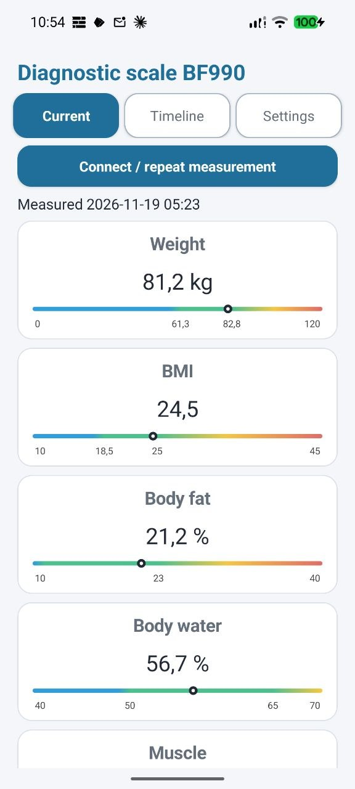
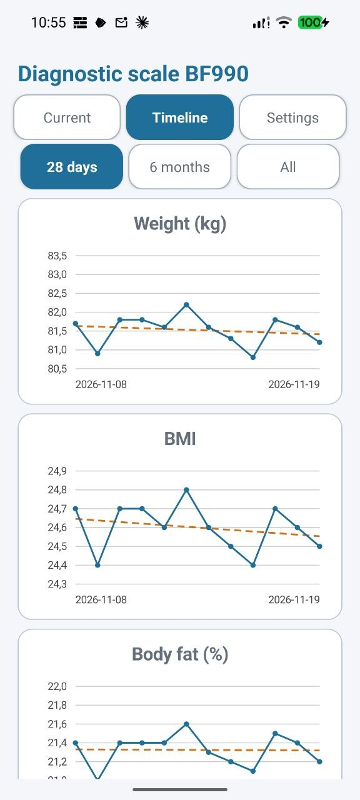
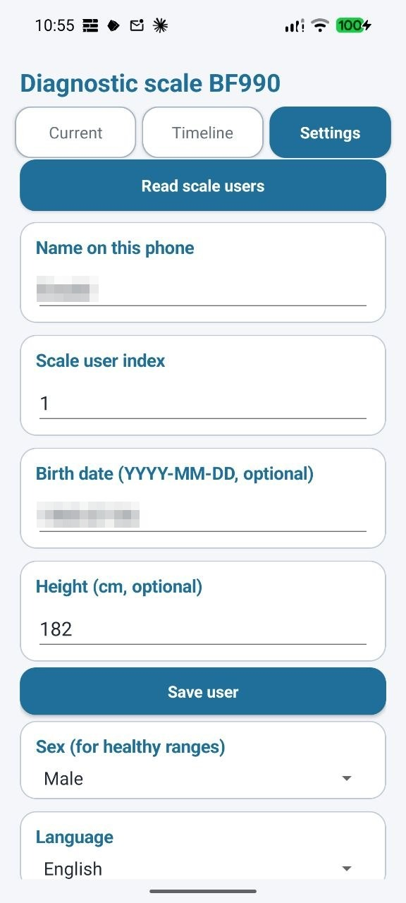
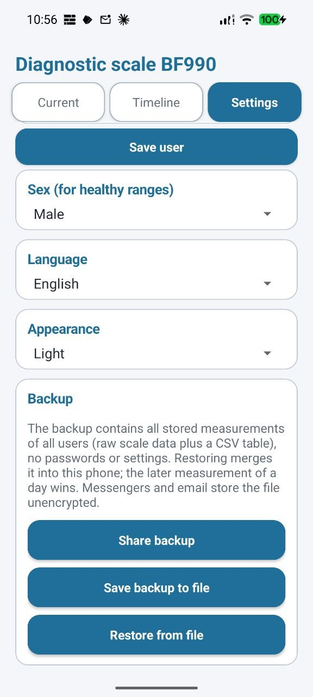

# BF990 scale app

An Android app that reads the **Beurer BF990** diagnostic scale directly over Bluetooth and keeps all measurements on your phone. It needs no account, no cloud and no Wi-Fi. It shows your current values with healthy ranges, draws the history of each value, and can copy all data to a second phone.

This is a private project, developed with the help of AI. It has been tested with one BF990 (firmware V02.13) and one Android phone. There is no app store release. The project uses the [MIT license](LICENSE).

## What you need

- A Beurer BF990 scale.
- An Android phone with Android 8.0 or newer and Bluetooth.
- The app's APK file. Ask the maintainer for it, or build it yourself as described in [Android development setup](AI/DEVELOPMENT.md).
- A user on the scale that uses the password this app is set up for. **The app cannot create scale users yet**; see [Known limitations](#known-limitations).

On first start, allow the app to find and connect to **nearby devices** (on Android 11 and older: location). Without that permission it cannot reach the scale.

## Taking a measurement

1. Open the app. If a user is set up, it starts looking for the scale right away.
2. Wake the scale by tapping it. The app shows "Ready. Step on the scale for a new measurement."
3. Step on the scale barefoot and hold the hand electrodes until the scale has finished.
4. The values appear on the **Current** page and are saved.

Only fresh measurements are accepted. A reading that is older than five minutes is ignored, because someone else may have stood on the scale under your user. If the connection drops or times out, wake the scale and tap **Connect / repeat measurement**.

One value per day is kept. If you weigh yourself twice on the same day, the later reading replaces the earlier one.

## Current

The **Current** page shows your latest measurement: weight, BMI, body fat, body water and muscle. When the scale reports it, the battery level is shown as well.

Each value has a colored bar with a dot marking your value:

- **Green** is the healthy range given in the BF990 manual. For weight it is the range where your BMI would be between 18.5 and 25 at your height.
- **Blue** means below the healthy range.
- **Yellow to red** means above it. For body water and muscle the bar ends in yellow, because a high value there is not a health concern.

The small numbers under the bar are the ends of the displayed scale and the limits of the green range. The healthy ranges for body fat, water and muscle depend on sex; choose yours in **Settings**. Without that choice the bars show a combined range.

The bars are a guide, not a medical assessment.

**Why body fat, water and muscle add up to more than 100 %.** Each value is its own share of your total weight; the three are not separate parts of your body. Only body fat and the fat-free rest (muscle, organs, bone, blood) add up to 100 %. Body water is mostly inside that fat-free rest, and muscle itself is about three quarters water, so the same kilograms count towards both water and muscle. A total of around 110–125 % is normal: even the middle of the healthy ranges for men (fat 17 %, water 57.5 %, muscle 47 %) adds up to about 121 %. Compare each value with its own green range, not the sum. The scale estimates these values from a small electrical current through the body, so the trend over several weeks says more than a single reading.

**Connect / repeat measurement** starts a new connection to the scale. It sits at the top of the page while there is no measurement from today or an error is shown, and moves to the bottom once today's measurement has arrived.

 

## Timeline

The **Timeline** page draws one chart per value. The buttons at the top choose the period:

- **28 days**: one point per day.
- **6 months**: daily points plus weekly averages.
- **All**: everything, with monthly averages for older data.

The app keeps daily values for 28 days. After that it combines them into weekly averages, and after six months into monthly averages. The original scale data is kept as well, so a backup always contains every single reading.

A dashed **trend line** runs through each chart. It is the straight line that best fits the points of the selected period, so you can see at a glance whether a value is going up or down.

Swipe left or right to change pages.

 

## Settings

The **Settings** page is longer than the screen, so it is shown in two parts.

### Users

The scale can store several people. Each person has a number on the scale, the **scale user index**. Agree in your household who has which number.

1. Tap **Read scale users** and wake the scale. The app lists the users it can access, with their birth dates.
2. Tap your entry. Index, birth date and height are filled in.
3. Enter the **name on this phone**. The name is only stored on this phone.
4. Tap **Save user**. From now on the app reads this user's measurements.

If a user is missing from the list, try again. A missing user may also use a different password; the app cannot tell.

**Birth date** and **height** are stored on the scale and used for its body calculations. If you change them here and tap **Save user**, wake the scale: the app checks the current values on the scale and then writes the new ones. Old measurements are not recalculated.

 

### Display and backup

- **Sex (for healthy ranges)** only changes the green ranges on the Current page. It is not sent to the scale.
- **Language**: English, German, or the phone's language.
- **Appearance**: light, dark, or as the phone is set.

**Backup** copies all stored measurements of all users into one file named like `bf990-backup-2026-11-19.zip`. It contains the raw scale data and a table (`measurements.csv`) you can open on a PC. It does not contain passwords or settings.

- **Share backup** sends the file through Telegram, email or another app.
- **Save backup to file** stores it, for example in Downloads or a cloud folder.
- **Restore from file** reads a backup back in.

Messengers and email store the file unencrypted, so treat it like any other health record.

 

## Moving data to a second phone

1. On the first phone, tap **Share backup** or **Save backup to file**.
2. On the second phone, install the app and either tap the received file and choose this app ("Open with" or "Share"), or use **Restore from file** in Settings.
3. The app shows how many readings are new, newer than the stored ones, already present, or invalid. Tap **Import**.

Restoring merges the data: nothing is deleted. If both phones have a reading for the same person and day, the later measurement wins. Then set up your own user in Settings on the second phone.

## Privacy

- Measurements, names and settings stay on the phone. The app sends nothing to the internet.
- The app talks only to the scale, over Bluetooth.
- A backup leaves the phone only when you share or save it.

## Known limitations

- The app cannot create scale users yet. The scale itself supports it over Bluetooth, and this was tested with the project's Linux tools: the app asks for a new user and the scale picks the next free number itself, so existing users are not overwritten. Until the app can do this, a new user has to be created with those tools on a Linux PC, using the app's password.
- The app can only reach scale users that use its password. A user with another password (for example one created by the Beurer app) does not appear in **Read scale users**, and the app cannot tell such a user from an empty slot. It also cannot change that user's data, because the scale rejects the wrong password.
- The app uses one fixed password for all scale users. It is visible in the source code.
- The scale clock is not corrected yet. Measurement dates come from the scale, so if its clock is wrong, the dates are too.
- Heart rate and other values the scale shows on its own display are not read.
- Only the BF990 is supported. Other Beurer scales use different data and may not work.

## Common messages

| Message | What to do |
|---|---|
| No BF990 was found within 20 seconds | Wake the scale, keep the phone nearby, and try again. |
| Bluetooth permission was denied | Allow "Nearby devices" (older Android: location) for the app in Android settings. |
| User authorization failed | Check the scale user index in Settings. The user may use a different password. |
| Waiting for a measurement timed out | Wake the scale and tap **Connect / repeat measurement**. |
| Nothing to import | Every reading in the backup is already on this phone, or older. |

## For developers

The project also contains Linux tools that were used to work out the scale's Bluetooth protocol. Start with:

- [Project status and documentation map](AI/MAIN.md), [current handover](AI/HANDOVER.md), [work queue](AI/TODOS.md)
- [Android development setup](AI/DEVELOPMENT.md): build, signing, installation, emulator
- [Linux tools](AI/LINUX_TOOLS.md): connection proof, capture, local user setup, offline decoder
- [BF990 protocol observations](docs/BF990-protocol.md)
- [Contributor and AI agent rules](AGENTS.md)

Never commit device addresses, passwords, personal profiles or measurements. Local data belongs in the ignored `database/` folder.

## Icon attribution

App icon: [Weighing scale by Pixel perfect](https://www.flaticon.com/free-icon/weighing-scale_776792), via Flaticon. The icon is provided under the Flaticon license and requires attribution; it is not covered by the project's MIT license.
