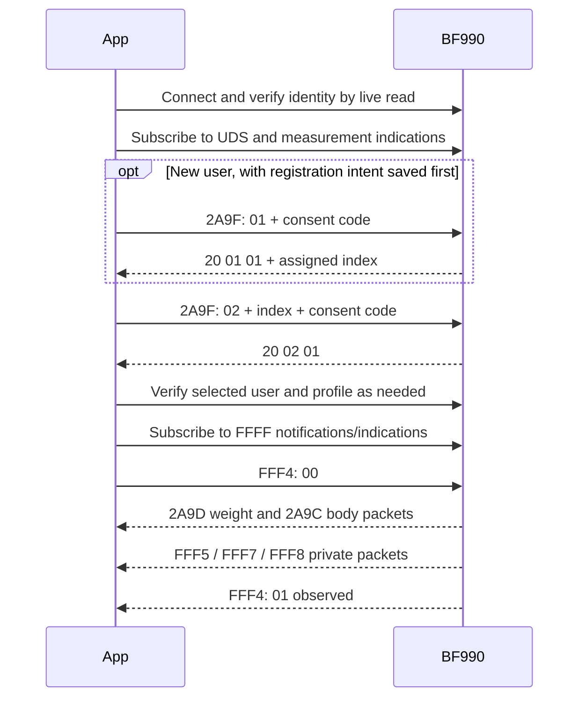

# BF990 Bluetooth protocol: observed behavior

This is an independent description of observations made with one BF990 running firmware V02.13, not a manufacturer specification. Findings are limited to the captured sessions and the packet formats described below. Do not assume other firmware, flags, units, or related models behave identically. [Device evidence](../AI/DEVICE_API.md), [capture notes](../AI/CAPTURE.md), [data format](../AI/DATA_FORMAT.md), and [user setup](../AI/LOCAL_PROFILE.md) contain the validation history and remaining uncertainty. Actual profiles, identifiers and payloads are kept locally outside the repository.

## Connection and services

The scale acts as a Bluetooth LE GATT server. Fresh reads returned manufacturer, model, firmware, battery, and feature values through Device Information (180A), Battery (180F), Weight Scale (181D), and Body Composition (181B). User Data (181C) was used for user setup. Private services FFFF, FFEF and FFCF were observed. A cached advertisement, pairing, or a service list alone is not proof of a connection: successful live characteristic reads and a connected state are required. Feature values observed on this device were `9f 00 00 00` for weight and `cf 10 00 00` for body composition.

UUIDs below are 16-bit short forms; characteristics are identified together with their parent service. Multi-byte values in the observed packets are little-endian.

## User registration and consent

The following sequence was verified for one local user. Its safety measures matter because an interrupted registration can leave an unknown result.

1. Verify the device model through a live read and subscribe to User Data Control Point (181C/2A9F) indications. Confirm the current User Index (181C/2A9A) is `ff` before attempting registration; this does not prove that all user slots are empty.
2. Generate and persist a consent code and a registration-pending state **before** sending Register New User: opcode `01`, followed by the two-byte little-endian consent code. A matching successful response starts `20 01 01` and includes the assigned user index as the fourth byte. Persist that index immediately.
3. Authorize the saved user by sending opcode `02`, user index, and two-byte little-endian consent code. A matching success response starts `20 02 01`; read back the selected user index and verify it matches.
4. For initial setup, write and freshly read back date of birth (181C/2A85: year uint16, month and day bytes), gender (2A8C: one byte), height (2A8E: two-byte integer centimetres on this device), and Database Change Increment (2A99: four bytes). The implementation reads field lengths before writing and handles revision updates. Activity level was not changed.

When registration has an unknown outcome, do not automatically send another registration request. Preserve the saved state and consent code; if an index is known, authorize the same user. A consent timeout alone is not evidence that the user must be recreated. Deletion, user enumeration and activity-level writes have not been verified.

## Measurement transfer

After consent, subscribe to standard weight and body measurement indications and the available notification/indication characteristics under service FFFF. Writing byte `00` to FFFF/FFF4 then produced standard and private measurement packets in the observed sessions. FFF4 subsequently emitted `01`, consistent with a successful request; the status alone does not prove measurements arrived. Wait for actual live measurement packets. The transfer can include historical readings and retransmissions; packet counts do not necessarily equal new weighing cycles.

The diagram describes the observed flow, not a guarantee of exact notification ordering.

## Weight measurement: 181D/2A9D

Observed metric layout: 15 bytes, flag byte `0e`.

| Offset | Bytes | Field | Observed interpretation |
| --- | --- | --- | --- |
| 0 | 1 | Flags | `0e` in captured frames |
| 1 | 2 | Weight | unsigned integer × 0.005 kg |
| 3 | 7 | Timestamp | year uint16, then month, day, hour, minute, second bytes |
| 10 | 1 | User index | scale-assigned index |
| 11 | 2 | BMI | unsigned integer × 0.1 |
| 13 | 2 | Height | unsigned integer × 0.001 m |

## Body composition: 181B/2A9C

Observed metric layout: 14 bytes, flags `0398` interpreted as a little-endian uint16. These packets have no timestamp or user index in the observed layout.

| Offset | Bytes | Field | Observed interpretation |
| --- | --- | --- | --- |
| 0 | 2 | Flags | `0398` |
| 2 | 2 | Body fat | unsigned integer × 0.1 percent |
| 4 | 2 | BMR | unit not validated; retain raw |
| 6 | 2 | Muscle | unsigned integer × 0.1 percent |
| 8 | 2 | Soft lean mass | unit not validated; retain raw |
| 10 | 2 | Body water mass | unsigned integer × 0.005 kg; divide by paired weight and multiply by 100 for percent |
| 12 | 2 | Impedance | unit not validated; retain raw |

Pair a body frame only with an unambiguous preceding weight frame within the same capture session. Reject unsupported flags and lengths instead of applying these offsets universally. Preserve original bytes alongside decoded values. All-zero body payloads are treated as unavailable, not as zero-valued physiology.

The weight, BMI, body-fat, body-water and muscle conversions agreed with two displayed observations within display rounding. The two candidate readings were too similar to establish a unique cycle-to-packet assignment. Broader packet variants and precision remain unverified.

## Private packets and unknowns

| Characteristic under FFFF | Observed length | Interpretation |
| --- | --- | --- |
| FFF4 | 1 byte | `01` observed after start; status alone is insufficient to prove reception |
| FFF5 | 20 bytes | unknown; preserve raw bytes |
| FFF7 | 20 bytes | unknown; preserve raw bytes |
| FFF8 | 6 bytes | unknown; preserve raw bytes |

Heart rate, segmental measurements, visceral fat and the private field layout are not decoded. Heart rate was unavailable during the compared cycles but has worked on the device previously. Represent missing values as unavailable rather than zero. Do not assign private offsets by plausible numeric ranges alone. Timestamps have been interpreted as scale-local time for current/history classification; clock and timezone behavior need more validation.

## Sources and further validation

This document summarizes the project's live observations and synthetic decoder tests; it is not copied from a manufacturer protocol. Consult [research references](../AI/BF990_RESEARCH.md), including the Bluetooth SIG User Data procedure and the manufacturer user manual, and [observation guidance](../AI/OBSERVATIONS.md) for future comparisons. Do not place actual measurements, device addresses or consent codes in public examples.
