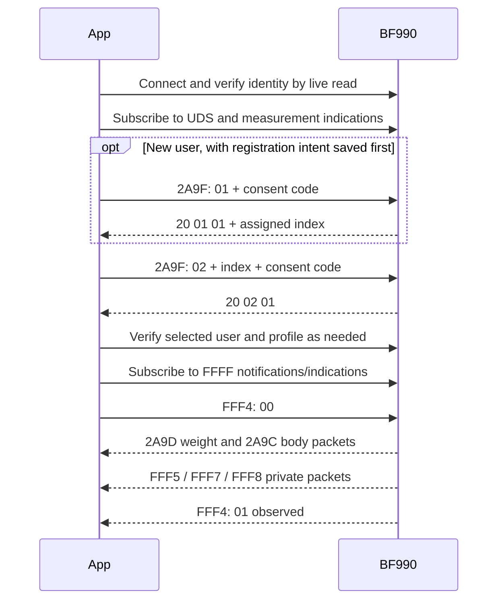

# BF990 Bluetooth protocol: observed behavior

This is an independent description of observations made with one BF990 running firmware V02.13, not a manufacturer specification. Findings are limited to the captured sessions and the packet formats described below. Do not assume other firmware, flags, units, or related models behave identically. [Device evidence](../AI/DEVICE_API.md), [capture notes](../AI/CAPTURE.md), [data format](../AI/DATA_FORMAT.md), and [user setup](../AI/LOCAL_PROFILE.md) contain the validation history and remaining uncertainty. Actual profiles, identifiers and payloads are kept locally outside the repository.

## Connection and services

The scale acts as a Bluetooth LE GATT server. Fresh reads returned manufacturer, model, firmware, battery, and feature values through Device Information (180A), Battery (180F), Weight Scale (181D), and Body Composition (181B). User Data (181C) was used for user setup. Private services FFFF, FFEF and FFCF were observed. A cached advertisement, pairing, or a service list alone is not proof of a connection: successful live characteristic reads and a connected state are required. Feature values observed on this device were `9f 00 00 00` for weight and `cf 10 00 00` for body composition.

UUIDs below are 16-bit short forms; characteristics are identified together with their parent service. Multi-byte values in the observed packets are little-endian.

## User registration and consent

The following sequence was verified for one local user. Its safety measures matter because an interrupted registration can leave an unknown result.

1. Verify the device model through a live read and subscribe to User Data Control Point (181C/2A9F) indications. Confirm the current User Index (181C/2A9A) is `ff` before attempting registration; this does not prove that all user slots are empty.
2. Generate and persist a consent code and a registration-pending state **before** sending Register New User: opcode `01`, followed by the two-byte little-endian consent code. A matching successful response starts `20 01 01` and includes the assigned user index as the fourth byte. Persist that index immediately.
3. Authorize the saved user by sending opcode `02`, user index, and two-byte little-endian consent code. A matching success response starts `20 02 01`; read back the selected user index and verify it matches.
4. For initial setup, write and freshly read back date of birth (181C/2A85: year uint16, month and day bytes), gender (2A8C: one byte), height (2A8E: two-byte integer centimetres on this device), and Database Change Increment (2A99: four bytes). The implementation reads field lengths before writing and handles revision updates. Activity level was not changed.

When registration has an unknown outcome, do not automatically send another registration request. Preserve the saved state and consent code; if an index is known, authorize the same user. A consent timeout alone is not evidence that the user must be recreated. Deletion of a disposable selected user has been observed as described below. Full user enumeration and activity-level writes remain unverified.

## Measurement transfer

After consent, subscribe to standard weight and body measurement indications and the available notification/indication characteristics under service FFFF. Writing byte `00` to FFFF/FFF4 then produced standard and private measurement packets in the observed sessions. FFF4 subsequently emitted `01`, consistent with a successful request; the status alone does not prove measurements arrived. Wait for actual live measurement packets. The transfer can include historical readings and retransmissions; packet counts do not necessarily equal new weighing cycles.

The diagram describes the observed flow, not a guarantee of exact notification ordering.

## Queued transfer timing observation

In one coordinated session, 14 earlier weight frames arrived over roughly 29 seconds after authorization, spaced about 1.4–2.3 seconds apart. The explicit measurement-start command preceded the first observed frame, so the exact cause of historical transfer remains uncertain. A fresh reading later arrived about 98 seconds after authorization, followed by status `01`. No separate end-of-queue marker was identified. Arrival timing alone does not reliably distinguish queued from fresh readings; compare valid measurement timestamps with the appropriately tracked scale clock. See [handover](../AI/HANDOVER.md#queued-versus-new-measurement-timing-2026-11-08).

## Weight measurement: 181D/2A9D

Observed metric layout: 15 bytes, flag byte `0e`.

| Offset | Bytes | Field | Observed interpretation |
| --- | --- | --- | --- |
| 0 | 1 | Flags | `0e` in captured frames |
| 1 | 2 | Weight | unsigned integer × 0.005 kg |
| 3 | 7 | Timestamp | year uint16, then month, day, hour, minute, second bytes |
| 10 | 1 | User index | scale-assigned index |
| 11 | 2 | BMI | unsigned integer × 0.1 |
| 13 | 2 | Height | unsigned integer × 0.001 m |

## Body composition: 181B/2A9C

Observed metric layout: 14 bytes, flags `0398` interpreted as a little-endian uint16. These packets have no timestamp or user index in the observed layout.

| Offset | Bytes | Field | Observed interpretation |
| --- | --- | --- | --- |
| 0 | 2 | Flags | `0398` |
| 2 | 2 | Body fat | unsigned integer × 0.1 percent |
| 4 | 2 | BMR | unit not validated; retain raw |
| 6 | 2 | Muscle | unsigned integer × 0.1 percent |
| 8 | 2 | Soft lean mass | unit not validated; retain raw |
| 10 | 2 | Body water mass | unsigned integer × 0.005 kg; divide by paired weight and multiply by 100 for percent |
| 12 | 2 | Impedance | unit not validated; retain raw |

Pair a body frame only with an unambiguous preceding weight frame within the same capture session. Reject unsupported flags and lengths instead of applying these offsets universally. Preserve original bytes alongside decoded values. All-zero body payloads are treated as unavailable, not as zero-valued physiology.

The weight, BMI, body-fat, body-water and muscle conversions agreed with two displayed observations within display rounding. The two candidate readings were too similar to establish a unique cycle-to-packet assignment. Broader packet variants and precision remain unverified.

## Private packets and unknowns

| Characteristic under FFFF | Observed length | Interpretation |
| --- | --- | --- |
| FFF4 | 1 byte | `01` observed after start; status alone is insufficient to prove reception |
| FFF5 | 20 bytes | unknown; preserve raw bytes |
| FFF7 | 20 bytes | unknown; preserve raw bytes |
| FFF8 | 6 bytes | unknown; preserve raw bytes |

Heart rate, segmental measurements, visceral fat and the private field layout are not decoded. Heart rate was unavailable during the compared cycles but has worked on the device previously. Represent missing values as unavailable rather than zero. Do not assign private offsets by plausible numeric ranges alone. Timestamps have been interpreted as scale-local time for current/history classification; clock and timezone behavior need more validation.

## Sources and further validation

This document summarizes the project's live observations and synthetic decoder tests; it is not copied from a manufacturer protocol. Consult [research references](../AI/BF990_RESEARCH.md), including the Bluetooth SIG User Data procedure and the manufacturer user manual, and [observation guidance](../AI/OBSERVATIONS.md) for future comparisons. Do not place actual measurements, device addresses or consent codes in public examples.

## Other-model commands to investigate (unverified on BF990)

The following are paraphrased from a BF600 transmission protocol (revision 002, dated 2017-12-06). Except for the specific BF990 observations identified in the table, they are **hypotheses for BF990**, not verified BF990 operations. Service UUID, characteristic properties, frame layouts, units and effects can differ. Check the full service/characteristic pair on the actual device; a matching short UUID does not establish compatibility. For example BF600 uses FFF0, while this BF990 exposed FFFF; BF990 FFFF/FFF5 emits 20-byte packets, unlike the BF600 reference-weight read. Never run unverified writes automatically. The recorded BF990 inventory lists FFFF/FFF2 as read and write-without-response, without the BF600 user-list notification property; FFFF/FFF1 has write-without-response and notify, but its meaning is unknown. See [capture inventory](../AI/CAPTURE.md).

| Candidate | BF600 behavior | BF990 status |
| --- | --- | --- |
| Delete selected user | 181C/2A9F request `03`; indication `20 03 result`. BF600 documents success `01`, unsupported `02`, failed `04`, unauthorized `05`. | On BF990 V02.13, a disposable selected user returned success, selection cleared, and its credentials were rejected after reconnect. User 1 was reauthorized. Stored-reading deletion and slot reuse remain unverified. The operation is destructive and supplies no index; verify selection before use. |
| List users | FFF0/FFF2: subscribe to notifications, then write `00`; no consent required on BF600. User events contain `00`, index, three initials bytes, birth year (little-endian uint16), month, day, one-byte height, gender and activity; one-byte `01` completes the list, `02` means no users. | Endpoint, access, layout, completeness and terminator unverified. BF990 standard profile height is two bytes, so do not reuse the proposed list layout without evidence. |
| Pending measurements advertisement | Service-data AD type `16` starts with `1d 18` and lists indices with undownloaded measurements. | Unverified. Two owner-coordinated 60 s BlueZ discovery scans each exposed one set of advertising properties with ServiceData, but neither key matched `0x181D`. This neither establishes a different BF990 ID nor identifies the payload; BlueZ properties are not a raw radio capture. Even if confirmed, this candidate would list users with pending data, not all occupied users; absence is not proof that a slot is empty. Private raw captures and limits are recorded in [handover](../AI/HANDOVER.md#bf990-advertising-scan-observations-2026-11-08). |
| Set/read clock | 1805/2A2B supports read, notify and a ten-byte write on BF600: little-endian year, month, day, hour, minute, second, weekday, fractional second and adjustment reason. Its procedure uses zero for the final three bytes. | BF990 V02.13 exposed read/write/notify; one local-time write succeeded, matched the immediate readback, and remained within two seconds of host time after reconnect while advancing. Timezone/DST, long-term drift, battery replacement, and effects on queued records remain unverified. |
| Scale settings | FFF0/FFF1 read/write: language, unit, time format and guest mode bytes followed by two-byte weight and body-fat thresholds. BF600 marks several fields unsupported. | BF990 endpoint, layout and effects unverified; do not write guessed values. |
| Activity | FFF0/FFF3 read/write one byte; BF600 levels are `01`–`05`, with `ff` for no selected user. | Unverified on BF990; activity writes remain disabled. |
| Reference weight | FFF0/FFF5 read returns two little-endian uint16 values for reference weight and body fat on BF600. | Unverified and not interchangeable with the observed BF990 FFFF/FFF5 notifications. |
| Measurement status | BF600 FFF0/FFF4 returns `01` success, `02` timeout, `03` failure, `04` no selected user. | BF990 FFFF/FFF4 `00` request and `01` response observed; the other meanings remain unverified. |
| User/revision limits | BF600 documents user indices 1–8, `ff` for no selection, and a database revision wrap from `fffffffe` to zero. | BF990 range, capacity and revision wrap unverified; a selected-index `ff` is not an empty-user-list result. |

BF600 says stored records can transfer after user assignment. BF990 captures already contain timestamps consistent with earlier readings, but delivery triggers, acknowledgement, completeness, deletion after transfer and retry behavior remain unverified. BF600 weight units differ from the values validated for BF990; do not substitute its measurement scaling.

## Raw advertising observation

A controlled before/after measurement capture produced live BF990 advertisements and scan responses in both windows. An additional advertisement variant occurred briefly after the measurement: one byte within manufacturer-specific advertising data differed, while the baseline variant also continued to appear and scan-response payloads did not change. Existing pending readings and other changing device state were not controlled; neither the cause nor the meaning of this byte is established. Private capture details and counts are in [handover](../AI/HANDOVER.md#raw-beforeafter-advertising-comparison-2026-11-08). Do not treat this observation as a pending-measurement indicator.

## Repeatable verification plan

Record firmware, full UUIDs and properties, prerequisites, timestamps and timezone, request/response bytes, expected versus observed behavior, and independent ground truth. Store raw captures and personal details only under ignored `database/`. Run one change at a time; repeat after reconnect, and distinguish timeout, unsupported, unauthorized and empty. For each case record the software revision, intended endpoint and properties, safety class, independent expected state and pre/post reads. Classify results as pass, fail or inconclusive, and repeat independently where possible. A timeout or unsupported operation does not prove an empty slot. A response alone is not proof of a durable change. Stop on unexpected state; never recreate a user after an uncertain registration or retry a destructive operation after a timeout.

1. **Offline and passive baseline:** review existing captures and exercise synthetic parsers, including malformed and truncated advertisements, unknown opcodes, duplicate and partial notifications, and terminators. Capture complete advertising structures before and after a deliberately recorded measurement, then compare pending indications and a second known user when available. A pending list cannot enumerate all users.
2. **Inventory and list:** verify BF990 identity with fresh reads and inventory full service/characteristic UUIDs and permissions. Only if the candidate endpoint exists, subscribe first, issue one explicitly coordinated list request, capture all events and compare against independently known occupied slots. Repeat across reconnect; no response or inaccessible user is not an empty slot.
3. **Existing user:** separately verify consent on the selected index, birth-date readback, and the new-phone credential path without creating or modifying another user. Preserve existing registration state and consent code.
4. **History:** arrange readings with known dates, capture complete transfers and compare timestamps and raw packet identities across repeated requests and reconnects. Check whether transfer changes pending advertising or removes records; do not assume retrieval is non-destructive, complete, or ordered.
5. **Clock:** only with the owner's agreement, record the existing clock and timezone, test on a controlled setting, freshly read back, reconnect and compare a subsequent measurement timestamp. Stop if clock or timezone semantics are unclear.
6. **Deletion, last:** only with explicit agreement for a disposable test profile, after safeguarding existing data and establishing reliable selection and pre/post inventory. Confirm the selected index immediately before a single request; inspect the response and verify persistence after reconnect. Never test on the existing household profile, and never infer deletion solely from a response code.

The disposable-user deletion observation above is the only additional candidate operation in this table verified on BF990 so far. The two passive BlueZ scans are inconclusive for advertising semantics. No unverified scale command is issued by this document.
